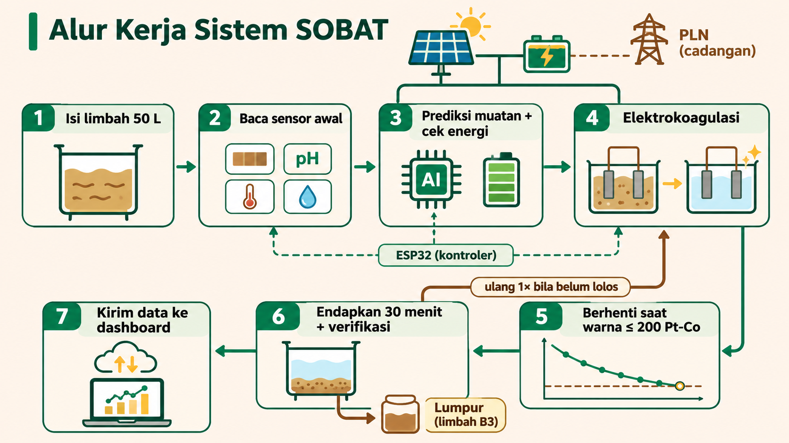

# SOBAT

**SOBAT** = **S**olar-powered **O**peration for **B**atik-wastewater **T**reatment, unit pengolah limbah batik bertenaga surya yang memakai elektrokoagulasi dengan elektroda besi.

SOBAT ditujukan untuk usaha batik dan pewarnaan tekstil skala kecil-menengah yang limbahnya tidak terlayani IPAL, atau terhubung ke IPAL yang tidak bisa diandalkan. Lokasi pilotnya Kampung Batik Laweyan, Solo. Proyek ini dibuat untuk UNS Innovation Hackathon 2026, Energy Track, sub-tema B (pengelolaan sampah dan ekonomi sirkular), dengan DLH Kota Surakarta sebagai problem owner.

> Status: prototipe perangkat lunak. Alatnya belum dirakit dan belum ada data eksperimen. Semua angka hasil berasal dari kembaran digital (digital twin) dengan parameter tebakan tim. Simulasi membuktikan logika sistem, belum membuktikan akurasi alat atau penghematan nyata. Firmware sudah terkompilasi tetapi belum pernah dijalankan pada papan ESP32.

Cara menjalankan dashboard di komputer sendiri (Docker atau tanpa Docker) ada di [dashboard/README.md](dashboard/README.md).

## Cara kerja

Arus DC melarutkan pelat besi menjadi gumpalan yang menangkap zat warna. Listriknya dari panel surya, dengan PLN sebagai cadangan. Sensor warna dibaca tiap 10 detik, dan kontroler menghentikan arus saat warna air memenuhi target baku mutu (200 Pt-Co, Permen LHK P.16/2019). Model ML memperkirakan muatan listrik yang dibutuhkan dari kondisi awal limbah, untuk perkiraan waktu, penjadwalan energi, dan peringatan anomali. Keputusan berhenti tetap dari sensor.

## Alur kerja sistem

1. Limbah 50 L dipompa ke reaktor.
2. Sensor membaca kondisi awal: warna (tiga kanal cahaya), pH, konduktivitas, suhu, dan kekeruhan. Limbah yang terlalu pekat untuk sensor diencerkan otomatis.
3. Model memperkirakan muatan listrik yang dibutuhkan. Kontroler mengecek daya surya dan baterai; bila kurang, batch menunggu matahari atau PLN menambal.
4. Arus dialirkan ke pelat besi. Warna dibaca tiap 10 detik, dan polaritas dibalik berkala untuk menahan pasivasi.
5. Arus berhenti saat warna mencapai target, warna tidak turun lagi, atau batas waktu tercapai.
6. Air diendapkan 30 menit, lalu warna akhir diverifikasi. Bila belum lolos, proses diulang sekali.
7. Ringkasan batch dikirim lewat MQTT ke server dan tampil di dashboard serta laporan untuk DLH. Lumpur ditampung sebagai limbah B3.

Kontroler berjalan di ESP32, jadi proses tetap jalan saat internet putus.

## Reaksi elektrokoagulasi

Dua pelat besi dicelup ke limbah dan dialiri arus DC. Pelat positif (anoda) larut, pelat negatif (katoda) memecah air.

| Tempat | Reaksi |
|---|---|
| Anoda | Fe(s) → Fe²⁺ + 2e⁻ |
| Katoda | 2H₂O + 2e⁻ → H₂(g) + 2OH⁻ |
| Dalam larutan (ada oksigen terlarut) | 4Fe²⁺ + O₂ + 10H₂O → 4Fe(OH)₃(s) + 8H⁺ |
| Dalam larutan (tanpa oksigen) | Fe²⁺ + 2OH⁻ → Fe(OH)₂(s) |
| Total (ringkas) | Fe + 2H₂O → Fe(OH)₂ + H₂ |

Fe(OH)₃ yang terbentuk berupa flok berpermukaan luas. Zat warna batik (azo, indigosol, naftol) tertangkap lewat adsorpsi ke permukaan flok, pengikatan muatan, dan penjebakan dalam flok yang mengendap atau terangkat gelembung H₂. Hasilnya lumpur besi yang mengikat zat warna, dan air yang warnanya turun.

Jumlah besi yang larut mengikuti hukum Faraday: m = I·t·M / (z·F), dengan M = 55,85 g/mol, z = 2, dan F = 96.485 C/mol. Dosis koagulan ditentukan oleh muatan listrik (arus × waktu), dan muatan inilah yang diperkirakan model AI. Pada alat nyata efisiensi arus tidak persis 100% (nilai simulasi 1,05), dan pasivasi menurunkannya seiring pemakaian.

Ini ringkasan kimia umum, bukan hasil pengukuran alat kami. Spesies besi di air limbah bergantung pada pH, oksigen terlarut, dan suhu, dan parameter simulasi masih tebakan sampai ada uji bench.

## Isi repositori

| Folder | Isi |
|---|---|
| [dashboard/](dashboard/) | Website pemantauan: frontend React, backend FastAPI, Docker, skrip demo, dan alat uji tampilan. Petunjuk menjalankan ada di sini. |
| [ML/](ML/) | Kembaran digital, kontroler acuan, model AI, parameter simulasi, data, dan hasil eksperimen |
| [firmware/](firmware/) | Firmware ESP32 untuk alat, rakitan rujukan, dan uji kecocokan dengan kontroler Python |
| [aplikasi/](aplikasi/) | Rencana aplikasi ponsel untuk perajin dan petugas |
| [docs/](docs/) | Laporan progres, kontrak data, analisis sensitivitas, dan dokumen lain |

Setiap folder punya README sendiri.

## Progres

| Bagian | Status |
|---|---|
| Kembaran digital, surya dan baterai (irradiansi Solo 2024), kontroler | Berjalan, ada tes |
| Model AI (gradient boosting dengan prior fisika) | Berjalan, baru dilatih dari data simulasi |
| Eksperimen: strategi kendali, sumber energi, ukuran panel, sensitivitas, ketahanan model | Berjalan (simulasi) |
| Backend, MQTT, InfluxDB, Docker | Berjalan lokal |
| Dashboard (Pantauan, Batch, Perbandingan, Rekomendasi, Laporan, Model AI) | Berjalan, juga di ponsel |
| Firmware ESP32 | Terkompilasi, keputusannya sama dengan kontroler Python; belum dicoba pada papan |
| Aplikasi ponsel | Rencana |
| Perangkat keras, uji bench, data lab | Belum |
| Server online (TLS, Caddy, DuckDNS) | Belum dicoba |

Laporan lengkap progres dan kekurangannya ada di [docs/laporan.pdf](docs/laporan.pdf).

## Hasil simulasi sementara

Angka ini bukan hasil eksperimen. Kondisi dasar, 100 batch acak, irradiansi Solo asli:

| Strategi | Lolos 200 Pt-Co | Energi (kWh/m³) | Waktu proses |
|---|---|---|---|
| Waktu tetap, disetel rata-rata | 59% | 0,88 | 61 menit |
| Waktu tetap, disetel aman | 89% | 1,49 | 104 menit |
| Umpan balik sensor | 95% | 0,99 | 68 menit |
| AI (prediksi dan umpan balik) | 95% | 0,99 | 68 menit |

Keunggulan utama datang dari umpan balik sensor. Pada kondisi normal AI tidak menambah mutu air; manfaatnya muncul saat daya surya terbatas. Rincian hasil, asumsi yang paling berbahaya, dan batas model AI ada di [ML/README.md](ML/README.md).

## Keselamatan

Elektrolisis menghasilkan gas hidrogen, jadi unit harus berada di ruang berventilasi dan jauh dari api. Tegangan sel rendah (paling tinggi 15 V DC), tetapi tetap pakai sarung tangan dan kacamata. Jangan menambah garam dapur berlebihan karena berisiko membentuk gas klorin. Endapan diperlakukan sebagai limbah B3 (PP 22/2021) dan tidak dibuang ke saluran. Panel surya dan baterai LiFePO4 wajib bersekring.

## Lisensi

[MIT](LICENSE). Data NASA POWER dan sumber lain tetap tunduk pada ketentuan masing-masing.
